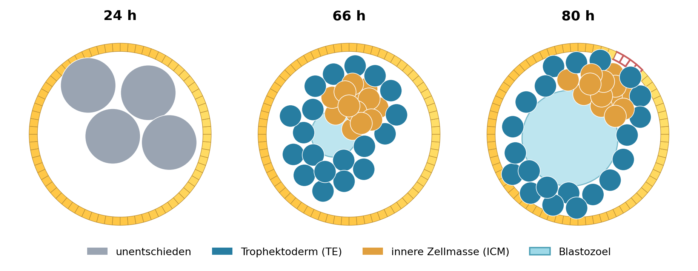

# EMBRYO-SIM

**Eine agentenbasierte Heuristik zur Modellierung früher embryonaler Selbstorganisation**  
*Computational Physiology · aktueller Modellstand: Stufe 1*

## Kurzbeschreibung

Embryo-Sim untersucht, ob aus wenigen lokalen Regeln eine blastozystenähnliche Zellorganisation entstehen kann. Individuelle Zellteilungen, mechanische Zell-Zell-Interaktionen und ein geometrisches Expositionssignal erzeugen eine äußere Trophektoderm- (TE-) und eine innere Zellpopulation (ICM). Eine heuristisch beschriebene Flüssigkeitshöhle und ein segmentierter Ring für die Zona pellucida ergänzen die Morphogenese.

Das Modell ist als **2D-Äquatorialschnitt** angelegt. Es bildet weder die tatsächliche Genregulation noch die spätere Aufteilung der inneren Zellmasse in Epiblast und Hypoblast explizit ab.

> **Aktueller Scope:** Zygote → Furchung → morulaähnliche Kompaktierung → erste Linienentscheidung (TE/ICM) → Blastozysten-ähnliche Struktur mit Blastozoel und modelliertem Zona-Hatching. Epiblast, Hypoblast, Implantation und Gastrulation sind geplante Erweiterungen und noch keine Ergebnisse der vorliegenden Version.

## Inhalt

- [1. Biologischer Hintergrund](#1-biologischer-hintergrund)
- [2. Fragestellung und Modellumfang](#2-fragestellung-und-modellumfang)
- [3. Computational Model](#3-computational-model)
  - [3.1 Agenten und Datenstruktur](#31-agenten-und-datenstruktur)
  - [3.2 Zellteilung und Gewebemechanik](#32-zellteilung-und-gewebemechanik)
  - [3.3 Geometrische Schicksalsentscheidung](#33-geometrische-schicksalsentscheidung)
  - [3.4 Blastozoel und Zona pellucida](#34-blastozoel-und-zona-pellucida)
- [4. Referenzlauf und virtuelle Experimente](#4-referenzlauf-und-virtuelle-experimente)
- [5. Interpretation und Limitationen](#5-interpretation-und-limitationen)
- [6. Nächste Entwicklungsschritte](#6-nächste-entwicklungsschritte)
- [7. Implementierungshinweise](#7-implementierungshinweise)
- [Literatur](#literatur)

## 1. Biologischer Hintergrund

Die menschliche Entwicklung beginnt mit der totipotenten Zygote. Während der Furchung entstehen durch wiederholte mitotische Teilungen kleinere Blastomeren, ohne dass das Gesamtvolumen des Embryos zunächst wesentlich zunimmt. Im Bereich des 8- bis 16-Zellstadiums verdichten sich die Zellkontakte (Kompaktion); zugleich werden innere und äußere Zellpositionen sowie apiko-basale Polarität erkennbar. Die erste große Linienentscheidung führt zur äußeren **Trophektoderm-Schicht (TE)** und zur **inneren Zellmasse (ICM)**. Das TE bildet später trophoblastäre Gewebe, während die ICM den embryonalen Anteil hervorbringt [1–3].

Die ICM differenziert anschließend weiter in **Epiblast (EPI)** und **primitives Endoderm (PrE; beim Menschen häufig als Hypoblast bezeichnet)**. Der Epiblast liefert den eigentlichen Embryo; der Hypoblast trägt unter anderem zu extraembryonalen Strukturen wie dem Dottersack bei. Diese zweite Linienentscheidung ist von der ersten TE/ICM-Trennung zu unterscheiden [2–4]. Während der späteren Gastrulation entstehen aus dem Epiblast durch Zellbewegungen und epithelial-mesenchymale Transition die drei embryonalen Keimblätter. Diese Prozesse liegen jenseits des gegenwärtigen Implementierungsumfangs, aber sollen integriert werden [2, 4].

## 2. Fragestellung und Modellumfang

Die Leitfrage lautet: **Können mechanobasierte Heuristiken aus homogem modellierten Zellen eine stabile, humane Embryonalentwicklung darstellen?**

Die Zellen besitzen im Programm zunächst denselben undifferenzierten Zustand. Die biologische Pluripotenz wird jedoch nicht als eigene Zustandsvariable abgebildet. Der derzeitige Scope reicht von einer einzelnen Zygote über Furchung und morulaähnliche Kompaktierung bis zur Ausbildung von TE, ICM, Blastozoel und einer lokalen Öffnung der Zona pellucida.

Die Simulation ist eine phänomenologische Modellierung von Selbstorganisation. Sie soll nachvollziehbar machen, wie räumliche Lage, mechanische Wechselwirkungen und zeitverzögerte Zustandsregeln gemeinsam zu einer strukturierten Zellpopulation führen können. Sie ist keine molekulare Simulation der menschlichen Embryogenese.

## 3. Computational Model

### 3.1 Agenten und Datenstruktur

Die Klasse `Simulation` verwaltet die Zellen nicht als einzelne Python-Objekte, sondern vektorisiert in parallelen NumPy-Arrays. Pro Zelle werden unter anderem folgende Größen gespeichert:

- Position und Radius,
- Zellalter und individuelle Zellzyklusdauer,
- Zellschicksal (`UNDECIDED`, `TE`, `ICM`),
- geglättetes Expositionssignal und aktuelle Schicksalstendenz,
- Teilungsgeneration und eindeutige Zell-ID,
- Status innerhalb oder außerhalb der Zona pellucida.

Diese Datenstruktur ist eine technische Implementierungsentscheidung. Konzeptionell entspricht jede Zelle einem Agenten, dessen Zustand lokal aktualisiert wird. Eine `cKDTree`-Nachbarsuche dient dazu, räumlich nahe Zellpaare effizient zu identifizieren.

### 3.2 Zellteilung und Gewebemechanik

- **Furchung:** Die mittlere Zellzyklusdauer beträgt 12 h mit einem Variationskoeffizienten von 10 %. Die Zellzyklen sind dadurch nicht synchron. Bei einer Teilung wird der Radius mit `2⁻¹ᐟ²` multipliziert; im 2D-Modell halbiert dies die Querschnittsfläche jeder Tochterzelle. Ein Mindestradius von 0,20 und eine Obergrenze von 34 Agenten begrenzen die Simulation.
- **Mechanik:** Zellen werden als weiche Kreise behandelt. Bei Überlappung wirkt eine lineare Abstoßung; im kurzen Abstand außerhalb des Kontakts wirkt eine glockenförmige Anziehung. Die Anziehung wird über eine schicksalsabhängige Adhäsionsmatrix moduliert. Zusätzlich wird radius-skaliertes Zufallsrauschen als vereinfachte, ungerichtete Motilität addiert.
- **TE-Teilung:** Ist die planare Teilung aktiviert, wird die Teilungsachse für TE-Zellen näherungsweise tangential zur Embryooberfläche ausgerichtet. Ein Winkelrauschen verhindert eine vollkommen starre Orientierung. Damit wird die Ausbildung einer einschichtigen Außenschicht begünstigt, nicht aber eine echte Epithelpolarität simuliert.

### 3.3 Geometrische Schicksalsentscheidung

Für jede Zelle wird aus den Richtungsvektoren zu ihren Nachbarn ein Expositionsmaß berechnet:

```text
E_i = ||Σ_j u_ij|| / n_i
```

Dabei bezeichnet `u_ij` den Einheitsvektor von Zelle `i` zu Nachbarzelle `j`, `n_i` die Zahl der berücksichtigten Nachbarn und `||...||` die Vektornorm. Bei einer innenliegenden, annähernd rundum umgebenen Zelle heben sich die Vektoren weitgehend auf (`E` nahe 0); bei einer Randzelle weisen sie überwiegend in dieselbe Richtung (`E` größer). Eine isolierte Zelle erhält `E = 1`. Das Maß beschreibt somit geometrische Randlage, nicht direkt die biochemische Signalstärke.

Das momentane Maß wird mit einer Zeitkonstante von 1 h geglättet. Ab einer Zellzahl von 8 kann eine stabile Tendenz nach mindestens 3 h zur Zuordnung führen:

| Bedingung | Modellentscheidung |
|---|---|
| Geglättetes Signal `≥ 0,45` | Trophektoderm (TE) |
| Geglättetes Signal `≤ 0,20` | Innere Zellmasse (ICM) |
| Zwischen den Schwellen | Zunächst unentschieden |

Ab 28 Zellen werden bereits zugewiesene Schicksale eingefroren; noch unentschiedene Zellen können weiterhin klassifiziert werden. Die Regel ist ein phänomenologischer Stellvertreter für positions-, polaritäts- und Hippo/YAP-assoziierte Prozesse, **keine Implementierung des Hippo-Signalwegs**. Gerade für menschliche Embryonen ist die genaue molekulare Kausalkette noch nicht vollständig geklärt [2, 3].

### 3.4 Blastozoel und Zona pellucida

**Blastozoel / Kavitation:** Nach dem Lock-in wird die Kavitation ab mindestens 28 Zellen und 6 TE-Zellen gestartet. Die Höhle wird als Flüssigkeitsscheibe modelliert, die angrenzende Zellen verdrängt. Ihre Fläche wächst durch einen TE-abhängigen Pumpterm (Na⁺/K⁺-ATPase als funktioneller Platzhalter), sofern der Zellring den Höhlenrand ausreichend abdichtet. Bei unzureichender Bedeckung tritt Leckage auf und die Höhle schrumpft bzw. kollabiert. Der Druck belastet zugleich den Zellverband und die Zona.

**Zona pellucida / Hatching:** Die Zona wird als Ring aus 72 Winkelsegmenten mit variierender lokaler Festigkeit modelliert. Der lokale Festigkeitsverlust setzt sich aus zwei Termen zusammen:

1. einem TE-abhängigen Enzymterm für Zellen im Wandkontakt,
2. einem mechanischen Term, der die Überlappung von Zellen mit der Wand berücksichtigt.

Die lokale Schädigung wird räumlich geglättet und durch eine positive Rückkopplung verstärkt: bereits geschwächte Segmente degradieren schneller. So kann eine bevorzugte Öffnungsstelle entstehen. Die Standardparameter gewichten den mechanischen Term stärker. Diese Gewichtung ist eine **Modellhypothese**, keine gesicherte Aussage zur menschlichen Hatching-Biologie [5, 6].

### 3.5 Biologische Vorgänge und ihre Modell-Approximation

| Biologischer Vorgang | Heuristik im Code | Was ausdrücklich nicht modelliert wird |
|---|---|---|
| Zelladhäsion / Kompaktion | Kurzreichweitige Anziehung plus Abstoßung bei Überlappung; Adhäsionsmatrix nach Zellschicksal | Cadherine, Aktomyosin und konkrete Kontaktproteine |
| Außen-/Innenlage und TE/ICM | Vektorbasierte Oberflächenexposition, zeitliche Glättung und Schwellenwerte | Genregulatorische Netzwerke, Morphogene und explizite Zellpolarität |
| Blastozystenhöhle | Flüssigkeitsscheibe; Fläche wächst TE-zahl- und abdichtungsabhängig, Zellen werden verdrängt | Ionen- und Wassertransport, Osmolarität und echte Tight Junctions |
| Zona-Hatching | 72 Segmente; lokaler Abbau durch TE-Kontakt und mechanische Überlappung, verstärkt durch positives Feedback | Molekulare Proteasen, reale Materialeigenschaften und aktive koordinierte Austrittsbewegung |

## 4. Referenzlauf und virtuelle Experimente

Ein lokaler Standardlauf mit `seed = 8` illustriert das Verhalten des Modells:

| Simulationszeit | Beobachtung |
|---:|---|
| 24 h | 4 undifferenzierte Zellen |
| ca. 61,5 h | Anlage des modellierten Blastozoels |
| 66 h | 32 Zellen; der Lock-in wurde erreicht und die Höhle ist bereits angelegt |
| ca. 78,1 h | Erste Öffnung der Zona pellucida |
| 80 h | 34 Zellen; 21 TE- und 13 ICM-Agenten |
| 90 h | 4 Zellen außerhalb der Hülle |

Die Zeitwerte sind interne, grob kalibrierte Simulationszeiten und dürfen nicht als präzise menschliche Entwicklungszeiten interpretiert werden.



*Abbildung 1: Eigene Referenzsimulation (seed = 8). Die Darstellung ist ein 2D-Äquatorialschnitt und keine maßstabsgetreue 3D-Abbildung.*

Das Notebook definiert drei Arten virtueller Perturbation:

1. **Blastomerenentfernung:** Entfernung einer Blastomere im 2-Zell-Stadium als vereinfachtes Halbembryo-Experiment.
2. **ICM-Ablation:** Entfernung aller ICM-Agenten vor bzw. nach dem Lock-in, um die im Modell eingebaute Schicksalsplastizität zu prüfen.
3. **Hatching-Perturbation:** Vergleich druck- und enzymdominanter Parametersätze, unter anderem mit Pumpen- bzw. Proteasehemmung, Zona-Härtung und künstlicher Öffnung.

Dies sind Versuchsdesigns des Notebooks. Da im bereitgestellten Notebook keine gespeicherten Ausgaben vorliegen, werden hier keine quantitativen Ergebnisse dieser Perturbationen behauptet.

## 5. Interpretation und Limitationen

Der Mehrwert des Modells liegt darin, dass räumliche Ordnung aus lokalen Interaktionen und wenigen expliziten Zustandsregeln emergieren kann. Die Simulation zeigt, wie eine geometrische Rand-/Inneninformation, differenzielle Adhäsion und eine einfache Flüssigkeitsmechanik die Entstehung einer blastozystenähnlichen Organisation unterstützen können. Sie zeigt **nicht**, dass die reale Embryonalentwicklung auf diese Regeln reduziert werden kann oder dass die gewählten Schwellenwerte biologische Parameter darstellen.

Wesentliche Limitationen:

- **Geometrie und Skala:** Das Modell ist ein 2D-Äquatorialschnitt. Zellzahlen sind Schnitt-Äquivalente; die Grenze von 34 Agenten ist eine Rechen- und Modellgrenze, keine natürliche Zellzahl. Die Zeitkalibrierung ist grob.
- **Biologische Mechanismen:** Es fehlen explizite Genregulation, Morphogengradienten, Zellpolarität, aktive gerichtete Zellmigration und Epithel-Zellverbindungen. Weil insbesondere abdichtende und mechanisch stabilisierende Zellkontakte fehlen, zerfällt der TE-Ring nach Öffnung der Zona; vollständiges Hatching und Implantation werden nicht abgebildet.
- **Hatching:** Die mechanische Rolle des Blastozystendrucks wurde experimentell in Mausblastozysten gestützt [5]. Für den Menschen ist die biochemische Grundlage des Zona-Abbaus weniger gut aufgeklärt; insbesondere sollte eine konkrete Proteasewirkung nicht als gesicherter menschlicher Mechanismus dargestellt werden [6].
- **Entwicklungsstadium:** Die Simulation bildet die erste Linienentscheidung TE/ICM ab. Epiblast- und Hypoblast-Differenzierung sowie Gastrulation sind noch nicht implementiert.

## 6. Nächste Entwicklungsschritte

Für die Modellierung von Epiblast und Hypoblast wäre eine **zweite Schicksalsentscheidung innerhalb der ICM** nötig, inklusive einer marker- oder signalbasierten Regel und räumlicher Sortierung an der Blastozystenhöhle. Danach wären 3D-Geometrie, Zellpolarität und junction-basierte TE-Abdichtung wichtige Voraussetzungen für eine sinnvollere Modellierung von Implantationsvorbereitung und späterer Keimscheibe.

Eine Erweiterung bis zur Gastrulation würde zusätzlich mindestens Achsenbildung, Primitivstreifen und EMT-/Ingressionsbewegungen erfordern. Diese Prozesse sollten als eigenständige Modellstufe behandelt werden, statt sie lediglich durch zusätzliche Zelltypen zu approximieren.

## 7. Implementierungshinweise

Vor einer finalen Auswertung sollten drei Code-Details überprüft bzw. bereinigt werden:

1. **Kommentar und Adhäsionsmatrix stimmen nicht überein:** Die Kommentare in `_default_adhesion()` beschreiben andere Faktoren als die tatsächlich verwendete Matrix. Implementiert sind derzeit TE–TE = 1,3, TE–ICM = 0,9 und ICM–ICM = 2,0. Entweder sollten die Kommentare oder die Parameter angepasst werden.
2. **Expositionssignal mit veralteter Nachbarschaftsgeometrie:** Die Nachbarvektoren stammen aus der Nachbarsuche vor den Positionsupdates desselben Zeitschritts. Für eine konsistente Momentaufnahme sollte die Nachbarsuche vor der Schicksalsentscheidung erneut ausgeführt werden.
3. **Terminologie in `FATE_NAMES`:** Der Anzeigename sollte von „Trophoblast (außen)“ auf „Trophektoderm (außen)“ geändert werden, da die Simulation die präimplantative Außenzelllinie abbildet.

## Literatur

1. Niakan KK, Han J, Pedersen RA, Simon C, Reijo Pera RA. **Human pre-implantation embryo development.** *Development*. 2012;139(5):829–841. [https://doi.org/10.1242/dev.060426](https://doi.org/10.1242/dev.060426) · [Open Access: PMC3274351](https://pmc.ncbi.nlm.nih.gov/articles/PMC3274351/)
2. Shahbazi MN. **Mechanisms of human embryo development: from cell fate to tissue shape and back.** *Development*. 2020;147(14):dev190629. [https://doi.org/10.1242/dev.190629](https://doi.org/10.1242/dev.190629) · Open Access.
3. Regin M, Essahib W, Demtschenko A, et al. **Lineage segregation in human pre-implantation embryos is specified by YAP1 and TEAD1.** *Human Reproduction*. 2023;38(8):1484–1498. [https://doi.org/10.1093/humrep/dead107](https://doi.org/10.1093/humrep/dead107)
4. Shahbazi MN, Pasque V. **Early human development and stem cell-based human embryo models.** *Cell Stem Cell*. 2024;31(10):1398–1418. [https://doi.org/10.1016/j.stem.2024.09.002](https://doi.org/10.1016/j.stem.2024.09.002) · Open Access.
5. Leonavicius K, Royer C, Preece C, Davies B, Biggins JS, Srinivas S. **Mechanics of mouse blastocyst hatching revealed by a hydrogel-based microdeformation assay.** *PNAS*. 2018;115(41):10375–10380. [https://doi.org/10.1073/pnas.1719930115](https://doi.org/10.1073/pnas.1719930115) · Mausmodell, Open Access.
6. Shafei RA, Syrkasheva AG, Romanov AY, Makarova NP, Dolgushina NV, Semenova ML. **Blastocyst Hatching in Humans.** *Ontogenez*. 2017;48(1):8–20. [PMID: 30272915](https://pubmed.ncbi.nlm.nih.gov/30272915/) · Review; englisches Abstract in PubMed.

---

*Projektbericht für Computational Physiology · Embryo-Sim · Stufe 1*
